# Alzheimer’s Disease Classification Using ConvNeXt

**Author:** Roan Perkins-McAuley (s48012050)  
**Course:** COMP3710  

---

## 1. Model Overview

### 1.1 The Problem

Alzheimer’s disease (AD) is a progressive neurological disorder associated with cognitive decline and structural changes in the brain. Early identification of Alzheimer’s disease may support clinical assessment and further investigation. This project investigates the application of deep learning to  classification of brain images into Alzheimer’s disease (AD) and cognitively normal (NC) categories.


### 1.2 The Models

ConvNeXt is a model that takes inspiration from two previous machine learning concepts, CNN's and vision transformers. The model takes transformed/augmented brain image/s as input and produces two class scores, corresponding to AD and NC, from which the predicted class is determined. Due to the medical context in which the model is used, it has two prediction modes once the model is trained, either 'flag' or 'mask' using a confidence threshold. In 'flag' mode, the model will flag predictions with low confidence, intended for routing these scans for human interpretation. In 'mask' mode, the model will default low confidence predictions to AD, respecting the fact that a false AD diagnosis is much less harmful than a false NC diagnosis. The confidence values are calculated using softmax from the class scores.

In addition to the ConvNeXt model, a standard CNN was implemented to serve as a baseline.


**Figure 1. ConvNeXt Implementation Architecture**

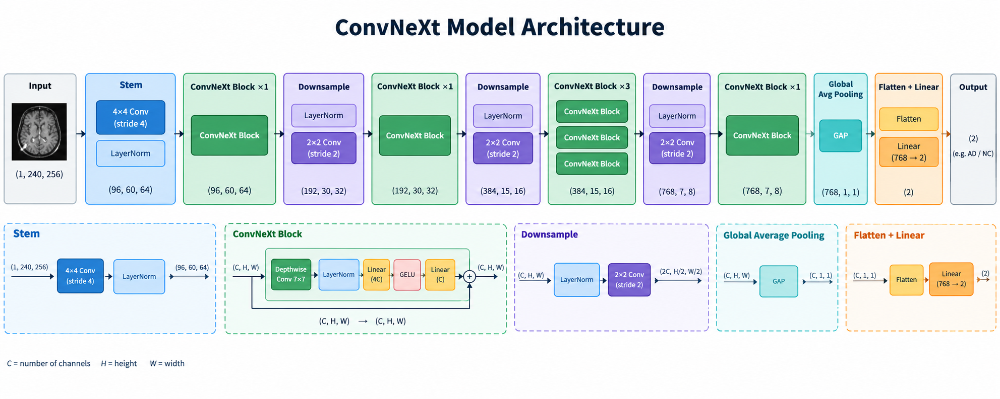


*ConvNeXt implementation, including block structure* 

---

## 2. Feasibility Review


## Feasibility Review - ConvNeXt on ADNI
Author: Roan Perkins-McAuley (s48012050)

### User Need:
The primary user of this data investigation would be medical professionals involved in the diagnosis of Alzheimer’s Disease (AD), with actual patients of AD serving as indirect users. The purpose of this prototype would be to investigate the feasibility of  the ConvNeXt model in assisting medical professionals diagnosing AD, with a large focus on reducing false negatives.

### Acceptance Criteria (Scope):
- 80% test accuracy on unseen data
- High AD recall, at least 90%
- training time on the order of hours (less than 2 hours)
- patient level separation on datasets, no patient has data which is split between multiple datasets
- at or below 40GB peak VRAM usage during training  (limit of smaller A100 GPU's in the rangpur cluster)

### Model Choice (Hard difficulty, ConvNeXt):
Implementation will be a modified version of ConvNeXt [1] to fit the 240x256 images in the ADNI dataset. It will mirror the architectural choices of the original design in terms of downsampling factors and channel scaling.

### Course Concepts:
Convolutions, Neural Networks & CNN's, Deep learning, Regularisation, Pattern Recognition

### Preliminary Feasibility Evidence:
- A baseline CNN trained on 1660Ti Super reached 64% test accuracy on smaller dataset
- Smoke-test run of the ConvNeXt model on the cluster reached 77% validation accuracy on full dataset. With added regularisation, a 80% test accuracy model is likely achievable
Both of these can serve as fallbacks

### Risks:
Project scope creep and misallocation of time resources, underestimation of computation runtime, unexpected difficulties achieving the acceptance criteria

### Computing Budget:
less than 2 hours per training run on rangpur (40+ GB GPU memory), possibility of longer training on my home computer (16GB GPU memory)

### Notable amendments
From the original (feasibility review)[docs/feasibility_review.md], an amendment has been made to the acceptance criteria. The line 'low false negative rate, at least below 10%' has been clarified to 'High AD recall, at least 90%'. These are logically equivalent statements, but recall is a more commonly reported statistic.

---

## 3. Dependencies and Reproducibility

### 3.1 Software Dependencies


| Dependency | Version |
|---|---|
| Python | 3.11.16 |
| PyTorch | 2.14.0+cu130 |
| Torchvision | 0.29.0+cu130 |
| scikit-learn | 1.9.1 | 
| Matplotlib | 3.11.2 |


### 3.2 Example Commands


Example commands:

```bash
# Train the baseline model
python train.py --model baseline {additional arguments, see train.py}

# Train ConvNeXt
python train.py --model convnext {additional arguments, see train.py}

# Evaluate a saved model
python predict.py {additional arguments, see predict.py}
```

### 3.3 Hyperparameters and algorithms

The following hyperparameter and supporting algorithms were used to train the ConvNeXt model.

| Setting | Value/Algorithm |
|---|---|
| Random seed | 42 |
| Batch size | 128 |
| Validation set size | ~5% of training data |
| Number of epochs | 38 |
| Optimiser | AdamW |
| Weight decay | 1e-4 |
| Initial learning rate | 1e-3 |
| Learning rate scheduler | Cosine annealing |
| Loss function | Cross Entropy Loss |
| Class Weights (loss) | 1.5x for AD |
| Max drop path probability | 0.1 |
| train/test/validation proportion | 0.65/0.3/0.05 |


Random seeds alone do not guarantee identical results during training, but they do guarantee the same train/validation split

---

## 4. Data and Preprocessing


### 4.1 Dataset Description

The dataset consists of labelled brain 240x256 pixel jpeg images (MRI slices) belonging to two classes: Alzheimer’s disease (AD) and cognitively normal (NC). The classes are each contained within their own folder and are relatively evenly split between the two classes. Each file in the dataset is identified by a patient and slice number ```{patient}_{slice}.jpeg```, with multiple slices per individual patient. The dataset is provided by the staff on UQ's rangpur cluster, with pre-split training and test examples For reasons discussed in 5.2, these folders are pooled together and then redistributed into training, test and validation splits according to the proportions in 3.3. These proportions were chosen so that the test, validation and training sets would each have approximately the same number of images as the original dataset, with a 20% validation split from the training folder.
The structure of the original dataset is as below, and as such the code will also expect this structure:

```text
dataset/
│
├── test/   # 9000 images
│   ├── AD  # 4460 images
│   └── NC  # 4540 images
│
├── train/  # 21520 images
│   ├── AD  # 10400 images
│   └── NC  # 11120 images
```

This dataset was pooled and re-distributed, ensuring that no patient-level data leakage was present. That is, that no patient has images which are contained in multiple datasets.

```text
Original pooled dataset
Images: 30520
Unique patients: 1526
Images per class: {'AD': 14860, 'NC': 15660}
Patients per class: {'AD': 743, 'NC': 783}
Images per patient - 20 (all patients have the same number of slices)

Training
Images: 19840
Unique patients: 992
Images per class: {'AD': 9660, 'NC': 10180}

Validation
Images: 1520
Unique patients: 76
Images per class: {'AD': 740, 'NC': 780}

Testing
Images: 9160
Unique patients: 458
Images per class: {'AD': 4460, 'NC': 4700}
```


### 4.2 Preprocessing and Augmentation

The following preprocessing operations are applied before images are supplied to the network. This happens every time an image passes through the network, meaning augmentation is randomly re-applied each time.


1. **Tensor conversion:** Convert image data into a PyTorch tensor.
2. **Normalisation:** Scales pixel intensities to the range [0,1]

**Augmentation (Training Only):**

3. **Affine Transform:** Small affine transformation, random angle between (-5, +5) degrees, horizontal and/or vertical shift by up to 3%, and zoom factor of between 0.95 and 1.05, all sampled uniformly
4. **Brightness/Contrast Transform** Random brightness and contrast transform between (-0.3, +0.3), also sampled uniformly

These augmentation changes significantly helped the model's generalisation ability

---

## 5. Training Process

Both models were trained for approximately the same amount of time (~1.5 hours), and from there, the model at the epoch with the best validation accuracy were evaluated on the test set.

### 5.1 Baseline CNN

The baseline model provides a reference point for assessing whether the more sophisticated ConvNeXt architecture offers meaningful improvements.

**Architecture:**
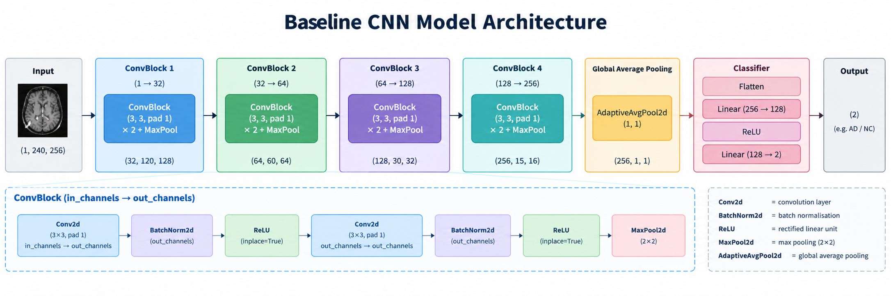


**Training configuration (noting only differences from 3.3):**

| Parameter | Value |
|---|---|
| Number of epochs | 35 (34 chosen as best) |
| Max drop path probability | 0 (not present) |

**Training Process:**
The training process for the CNN was relatively lite, as it is meant to serve as a baseline. A smoke-test was conducted on a subset of the data, then a full run was conducted using the pooled dataset split as described using generally accepted hyperparameters. The best validation accuracy epoch from this run was then evaluated on the test data and presented good results. This model achieved 94.43% accuracy on the test set.


### 5.2 ConvNeXt

**Training Process:**
In contrast, the training for the ConvNeXt model was much more involved. Several initial runs were conducted using a larger model, which had 3x as many blocks in the architecture, with no drop path. As expected, these models severely over-fit to the training data, achieving maximum validation accuracies of 77.8% and 67.2% respectively, while both reached ~100% training accuracy (these were ultimately not evaluated on the test set). The second run used Gaussian noise augmentation to attempt to improve generalisation, however this actually reduced the models validation accuracy.

From here, the affine transform augmentation and drop path (max probability of 0.2, linearly scaling per layer), as well as increase the weight decay to 1e-3 (from 1e-4) were added with immediate improvements. The model achieved a validation accuracy of 90%, but curiously was only able to achieve an accuracy of 72% on the test set. This model struggled in particular with diagnosing some specific patients in the AD class, whereby it would misclassify all of their slices as NC, giving the model a recall of only 0.56 (for the AD class).
This problem of the validation accuracy vs test accuracy gap became a major hurdle for training with seemingly no explainable cause after cross-patient contamination between the sets was eliminated as a possibility, and other trials were run using a different seed.

It was concluded that the pre-defined test set might contain patients which have slices somehow coming from a different distribution, which a visual inspect of failure cases could not identify. The best accuracy any model (baseline or ConvNeXt) was able to achieve on the test set was 75.9%, whilst both had validation accuracies about 90%.
At this point, it was decided that the `train/` and `test/` sub-folders would have all their images merged, and then re-split into training, test and validation datasets as described in 4.1. A first initial run reached a maximum validation accuracy of 86.2%, and subsequent trials for a longer training period resulted in a model which had 92.3% validation accuracy, and 92.1% test accuracy after training for 38 epochs.

This suggests that somehow the `test/` and `train/` datasets may follow different distributions, possibly originating from different studies, MRI machines, or some combination of other factors.


---

## 6. Training Results and Example Inputs

### 6.1 Example Input

Below is an example of the images in the dataset, and that same image under the transformations and augmentation described in 4.2. Images are 240x256 pixels in both cases.

**Figure 2. Example dataset image**

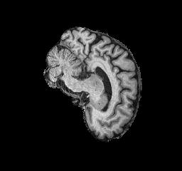


**Figure 3. Example preprocessed input image**

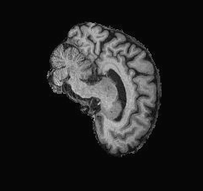


### 6.2 Training and Validation Curves

**Figure 4. ConvNeXt and Baseline Training and validation loss**

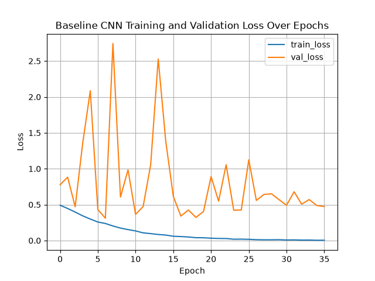
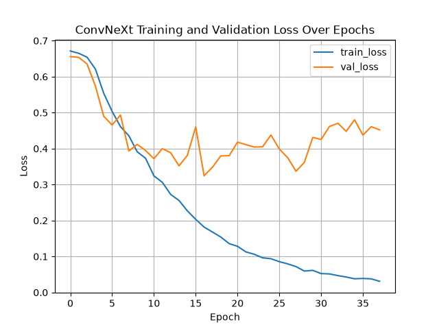

**Figure 5. ConvNeXt and Baseline Training and validation accuracy**

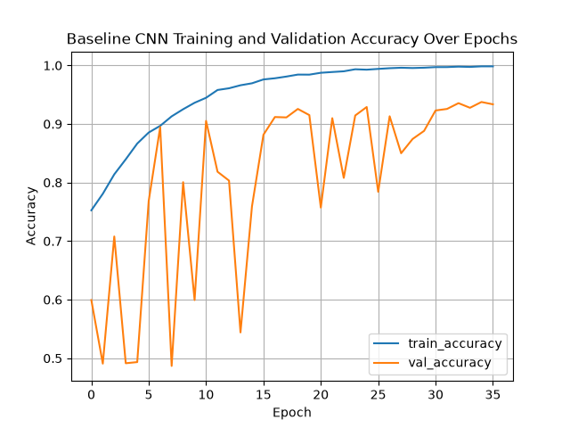
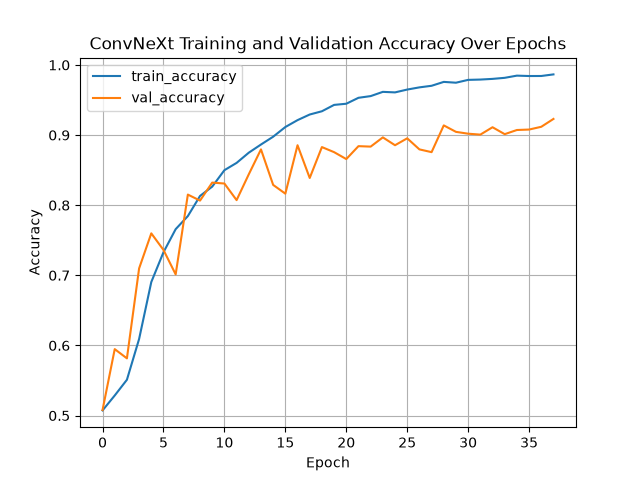


The first noticeable difference between the models training patterns is the relative stability of the ConvNeXt model compared to the baseline. Whilst the training curves for both models remain stable, the validation loss and accuracy are highly unstable for the CNN, and only began to converge towards the end of the experiment.

Another point to notice, in particular for the ConvNeXt model, is that whilst validation loss began to plateau around epoch 10, validation accuracy continues to steadily increase. This might be a result of the model becoming more confident in predictions, particularly incorrect ones. An analysis of the class specifics however, shows that the model at epoch 37 has higher recall and precision for both classes (on top of higher accuracy) on unseen data. Thus it was concluded that despite what the loss curve shows, the model at epoch 37 had not significantly over-fit to the training data and were therefore used in the final analysis.

For the baseline CNN, validation loss and accuracy only smooth out at the end of the experiment, with epoch 34 having the best validation accuracy, and this being used in the final analysis.

---

## 7. Investigation of the Open Research Dilemma


### 7.1 Quantitative Benchmarking

#### 7.1.1 Classification Metrics

| Metric | ConvNeXt | Baseline CNN | Difference |
|---|---:|---:|---:|
| Test accuracy (%) | 92.05 | 94.43 | -2.38 |
| Precision - AD | 0.9056 | 0.9540 | -0.0484 |
| Recall - AD | 0.9340 | 0.9304 | 0.0036 |
| F1-score - AD | 0.9196 | 0.9421 | -0.0225 |
| Precision - NC | 0.9355 | 0.9356 | -0.0001 |
| Recall - NC | 0.9076 | 0.9574 | -0.0498 |
| F1-score - NC | 0.9213 | 0.9463 | -0.025 |
| AUROC (AD Pos) | 0.9758 | 0.9823 | -0.0065 |


#### 7.1.2 Confusion Matrices

**Figure 6. Baseline CNN confusion matrix**


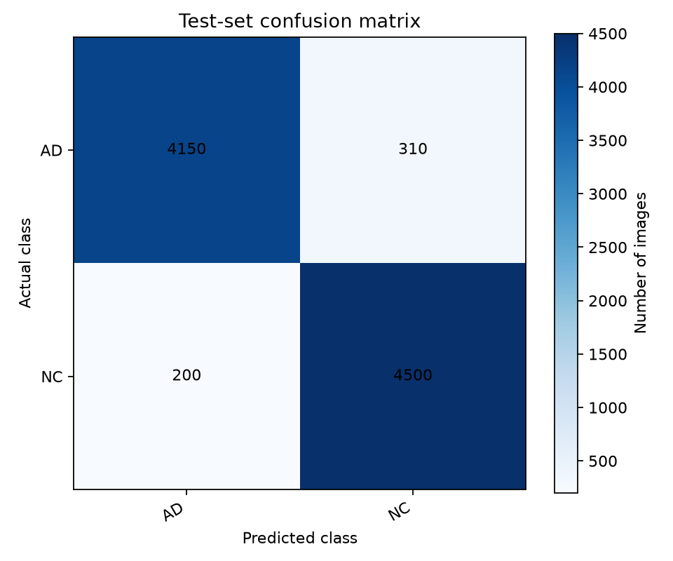

**Figure 7. ConvNeXt confusion matrix**

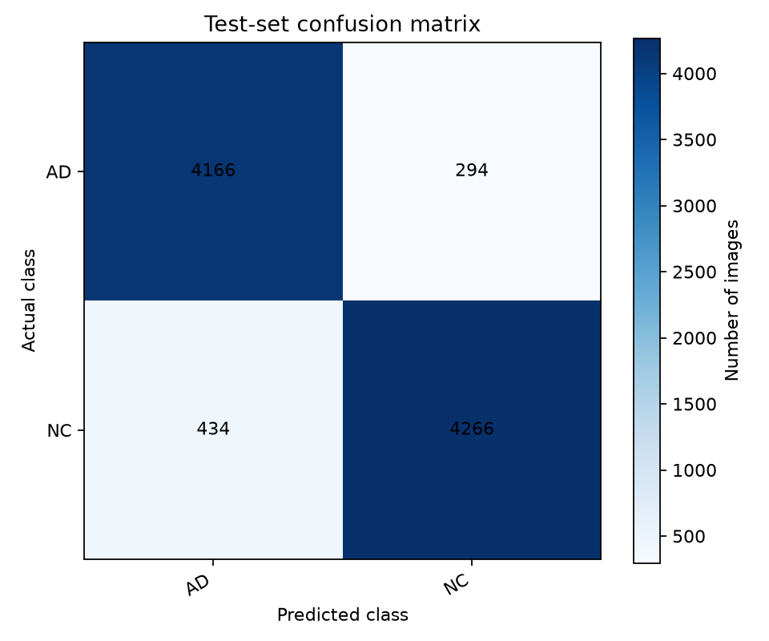

**Figure 8. Baseline ROC Curve**

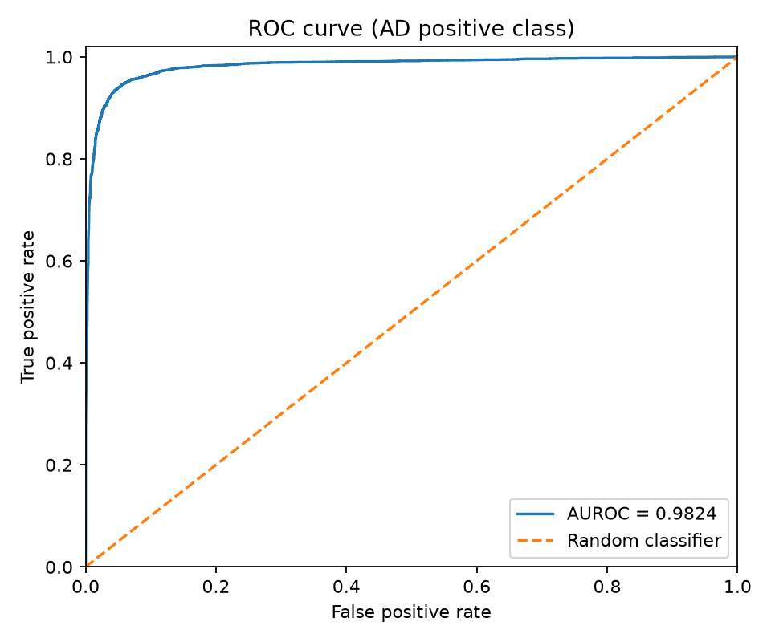

**Figure 9. ConvNeXt ROC Curve**

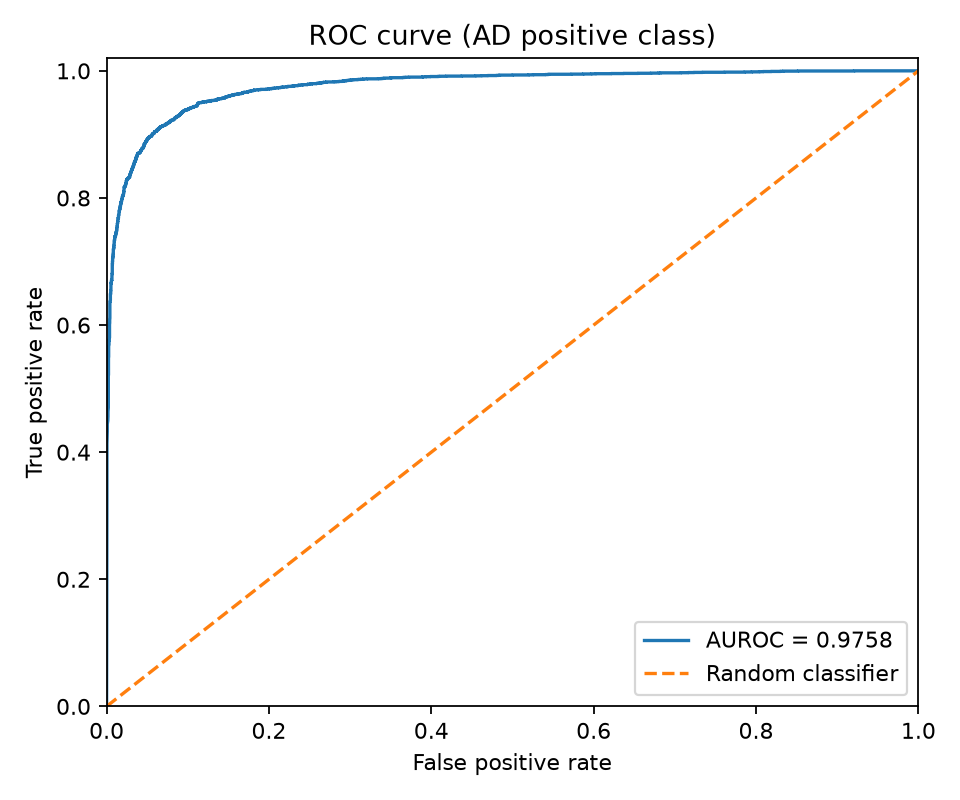

#### 7.1.3 Quantitative Analysis

The results of the quantitative analysis are actually quite interesting and counter-intuitive. The ConvNeXt model appears to have actually performed worse with the CNN being 2.38 percentage points more accurate on the test set, which is actually a significant difference. This is reflected across almost all metrics apart from AD recall, which is slightly higher for ConvNeXt. This is actually one of the metrics we care the most about given the context of the problem in the medical field, where a false negative is much more harmful than a false positive.

This is quite a disappointing result, and several attempts were made to improve the ConvNeXt models test performance via extended training, however the results presented above were the best observed.

In general, it seems that the baseline is better at identifying the NC class, whilst ConvNeXt is slightly better at identifying the AD class, which is perhaps one valid reason that ConvNeXt could be considered the superior model in the context of the problem, despite its lower overall quantitative statistics. 

### 7.2 Computational Resource Profiling

#### 7.2.1 Resource Comparison Table

| Resource metric | ConvNeXt | Baseline CNN | Relative Difference |
|---|---:|---:|---:|
| Trainable parameters | 10,308,578 | 1,205,794 | 8.55× larger |
| Checkpoint size (MB) | 121 | 14.2 | 8.52× larger |
| Peak allocated GPU VRAM during training (GB) | 6.56 | 9.21 | 28.8% less |
| Peak reserved GPU VRAM during training (GB) | 9.57 | 14.91 | 35.8% less |
| Average training images per second | 283.89 | 267.82 | 5.6% faster |
| Average inference images per second | 506.01 | 711.36 | 28.9% slower |


#### 7.2.3 Efficiency Analysis

The ConvNeXt model is approximately 8.5x larger than the baseline CNN in terms of trainable parameters, but interestingly uses significantly less GPU VRAM. This is likely due to the depth-wise convolutions, which would reduce the number of activations substantially compared to a typical cross-channel CNN architecture. Another interesting observation is that the ConvNeXt model is faster during training, but slower during inference. This is quite counter-intuitive, but could possibly be explained by the fact that both models were trained at different times on the Rangpur cluster, and as such were trained on different GPU's, possibly even different models. It is also worthwhile to note that an anecdotal analysis of the training throughput of other ConvNeXt training runs reveals this particular run was faster, which might indicate it was simply trained on better hardware this particular run.

Note both models always used the same batch sizes for inference.


### 7.3 Qualitative Error Autopsies

Here we inspect several representative failure cases from the ConvNeXt model. Since directly inspecting raw MRI images will make it almost impossible to diagnose failure triggers, we will look at the Grad-CAM of the image at the final convolutional block.
This is a technique used to visualize which parts of an image a convolutional network focuses on when making a prediction, which can often give interpretability to the results. Note however, that since ConvNeXt down-samples the height and width of these dimensions, the final Grad-CAM output is interpolated back up to the original size of the image (with the original superimposed in the background). Several Grad-CAM images for correctly identified examples are present in Appendix A, which will be used to compare to the incorrect examples.

**Analysis of Correct Grad-CAM's:**
Analysing firstly the Grad-CAM's of images the model has correctly classified, we can identify several patterns. Firstly, it is interesting to note how most activations are not concentrated around areas of the brain, but rather near border areas. This is not necessarily an indication that the model has not learnt genuine patterns however. Note that these plots come from the last convolutional layer in the model, which has likely already encoded various higher level features from the image. There is also somewhat a distinguishable pattern with some activation concentrations. Notice that for some correctly identified 'AD' examples, activations are high on the left hand side of the plot, whilst for 'NC' examples the highest activations are towards the top of the image. This is by no means a complete metric, there are examples where the model does not encode information this way, and there can be many other areas of the image with high activations. This is, however, an observation that is highly common through the prediction results, possibly indicating that such information might be indirectly correlated with the classification labels, without necessarily representing meaningful anatomical differences. It is also worthwhile to keep in mind that ConvNeXt's final feature representations have undergone substantial spatial downsampling, and Grad-CAM then maps the resulting activations back to the original image resolution. This means that high activation areas near the boundary might not necessarily originate from blank background pixels.


#### Case 1: Extremely confident false negative
`Patient: 1240482, Slice: 97`

This is the most dangerous of the errors the model made, especially in the context of medical diagnosis. In this case the model has learnt a representation that confidently identifies this image as NC, despite it being AD.

**Figure 10. Case 1 Original Image and Grad-CAM**

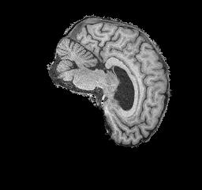

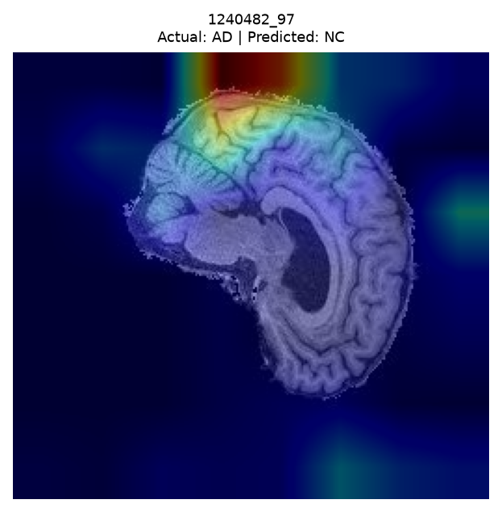


| Property | Result |
|---|---|
| Actual class | AD |
| Predicted class | NC |
| Confidence in AD | 1.7e-8 |
| Confidence in NC | ~1 |
| Error type | False Negative |

Here we can most obviously notice how focused the Grad-CAM is at the top section of the image, with very little activation actually focussed anywhere on the brain. Interestingly, this activation pattern resembles those observed in several correctly classified NC examples. This raises the possibility that the model is relying on spatial or image-level characteristics that are correlated with the NC class, rather than exclusively learning meaningful anatomical differences


#### Case 2: False negative with borderline confidence
`Patient: 1004740, Slice: 99`

In this case the model is very uncertain about its prediction, and ultimately predicts the wrong class as 'NC'. This error is less dangerous as the previous, as it can be detected easily with a confidence threshold rule, but is nonetheless present in multiple cases in the prediction results.

**Figure 11. Case 2 Original Image and Grad-CAM**

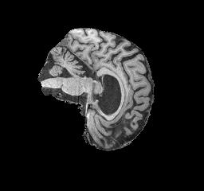

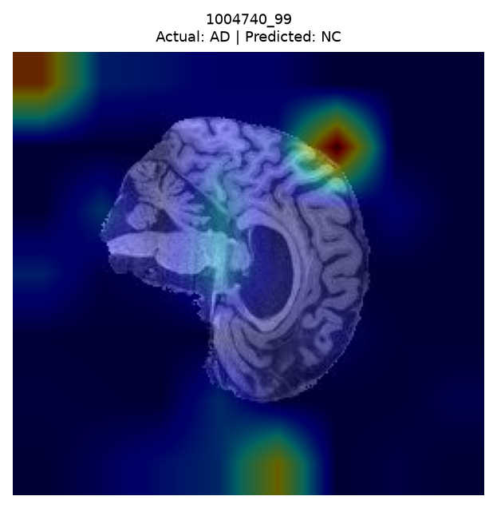

| Property | Result |
|---|---|
| Actual class | AD |
| Predicted class | NC |
| Confidence in AD | 0.4785 |
| Confidence in NC | 0.5215 |
| Error type | False Negative |

In the Grad-CAM plot we see that the areas of activation are completely different from those seen in correct examples, or even confidently wrong examples, with a note-able concentration in the top left corner and a dense concentration near the upper right boundary of the brain. This may indicate that the model is using a combination of anatomical and non-anatomical image features. Given the relatively low prediction confidence, it is also possible that the learned features provide relatively weak or ambiguous evidence for the predicted class.


#### Case 3: Highly confident false positive
`Patient: 1303143, Slice: 106`

This is the other end of the false confident predictions, where the model incorrectly predicts AD (false positive). This is less dangerous than a false negative, but is still an incorrect prediction. False positives are actually the most common error in the prediction results, a large proportion of which are also confidently incorrect.

**Figure 12. Case 3 Original Image and Grad-CAM**

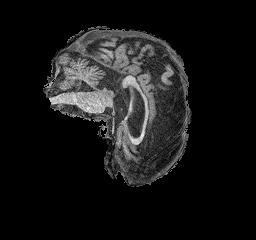

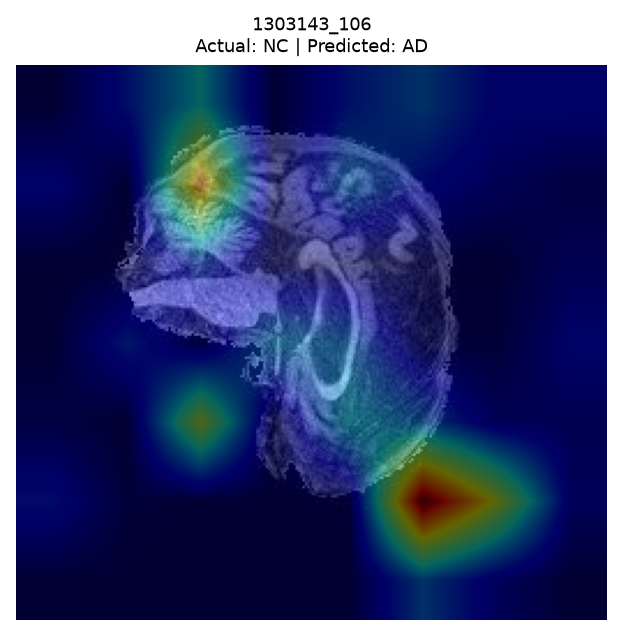

| Property | Result |
|---|---|
| Actual class | NC |
| Predicted class | AD |
| Confidence in AD | 0.9895 |
| Confidence in NC | 0.0105 |
| Error type | False Positive |

The strong activation outside the brain raises concerns that the model may be exploiting non-anatomical image characteristics. Such characteristics may be correlated with the training labels, allowing the model to achieve high confidence without necessarily identifying meaningful disease-related anatomical features. This could represent a potential source of poor generalisation.


#### 7.3.1 Cross-Case Analysis

In terms of visual examination of raw MRI slices, it is of course very difficult to find any similarities between the common failure types. The Grad-CAM activations on the other hand, do provide a way for us to investigate potential factors contributing to the failures, and even gain some insight into spatial information which influences the models predictions, even if only at a high level.

The other major conclusion from the case analysis, is that the model very regularly makes highly confident incorrect predictions. It was a goal of this project to attempt to reduce the models overconfidence, employing strategies such as loss function class weighting, but it was not enough.

One of the main struggles of the model seemed to be individual patients. There were 4 patients in the test set which had all 20 slices incorrectly predicted (3 were false negatives and one a false positive). This accounts for 11% of all incorrect predictions, which is a substantial proportion. The slices from the same patient are not independent, and thus these patients might contain characteristics  which makes prediction particularly difficult. This also highlights a limitation with prediction using individual slices, rather than all 20 slices from the same patient as the model input.

**Recurring triggers:** 

**Model-specific failures:** The main noticeable difference between the CNN and ConvNeXt is that the CNN was generally better at predicting NC examples, whilst the ConvNeXt model was slightly better at predicting AD examples.

**Interpretability findings:** Unfortunately, the Grad-CAM plots have not provided a clear idea of which image regions are particularly important for distinguishing between the classes. On the other hand, the baseline model actually presents some meaningful representations on the Grad-CAM plots, with activations being concentrated in certain areas of the brain, rather than boundaries (see Appendix B for several example plots). This might suggest that the model has not completely learnt generlisable anatomical biomarkers for Alzheimer's disease, and might generalise very poorly to MRI scans which are even slightly different in nature.

**Potential dataset limitations:**  The main limitation of the dataset is that it contains no other information about the patient (e.g. age, gender, risk factors) which would otherwise be highly beneficial in prediction. 

**Model/Architectural Factors:** Another possible limiting factor is that the model takes individual slices, rather than all slices as feature input. The slices between patients are thus not independent, and the model lacks any information about the other slices from a given patient when it is making its prediction. 3D, or 2.5D CNN could possibly perform better by exploiting this patient level information.

#### 7.3.2 Decision Rule recommendations

Implementing a decision rule that would route predictions below a certain confidence for human review would have yielded the following results on the test set:

| Threshold | % referred | % Errors Caught |
| --- | --- | --- |
| 0.60 | 1.36% | 7.55% |
| 0.70 | 2.77% | 15.25% |
| 0.80 | 4.22% | 23.21% |
| 0.85 | 5.19% | 28.02% |
| 0.90 | 6.35% | 32.97% |
| 0.95 | 8.42% | 42.45% |
| 0.98 | 10.93% | 50.82% |
| 0.99 | 12.93% | 57.83% |

A higher threshold obviously routes more predictions for human review, but it also catches more incorrect predictions. In practice, the model would be used in coordination with other tools, metrics and traditional medical assessments, so setting the threshold very high might not come with any real downsides. Despite this, for the purposes of this project, it will be recommended that the threshold is set around 0.95-0.98, as this appears to catch a large proportion of the errors (40-50%), whilst only routing ~10% of slices for human prediction.


### 7.4 Engineering Recommendation and Trade-Off Synthesis

This section translates the experimental findings into a recommendation for the project manager.

#### 7.4.1 Summary of Trade-Offs

Overall, the ConvNeXt model did not live up to its expectations over the baseline. The baseline CNN had better test data statistics practically across the board, had a faster inference time, and is generally less complex. It appears that the advantages presented by ConvNeXt were not enough and its complexity actually hindered interpretability, which is a very important factor in the context of the problem.

#### 7.4.2 Recommendation

**Recommended model:** Baseline for pure accuracy and interpretability, ConvNeXt for better AD recall.


**Key trade-offs:** Choosing this ConvNeXt model trades interpretability and pure accuracy for a higher AD recall, which although is perhaps its only advantage over the baseline, is still an important one. The baseline CNN on the other hand, whilst being quite complex for a traditional CNN, still compete's with the more complex models in terms of accuracy, whilst maintaining better interpretability in the context of the problem.

**Key Engineering Question:** Does the added architectural complexity and computational cost of the advanced model justify its operational advantage over the baseline?

It cannot be said that the added complexity of the ConvNeXt model has justified its specific advantage over the baseline CNN. The only advantage it does have, that being higher AD recall, is overshadowed by the other advantages presented by the baseline CNN. The CNN retains a higher test accuracy, with higher statistical metrics apart from AD recall, all whilst maintaining a greater contextual interpretability and simplicity.


---
## 8. Conclusion:

In terms of individual model performance, it can be said that the ConvNeXt model performed quite well. All acceptance criteria from the feasibility review were achieved, and the accuracy of the model on unseen data was quite good. Despite this, overall it must be concluded that the baseline CNN outperformed ConvNeXt on this project. The key investigations of this project were:

**1:** Does the chosen model architecture reliably quantify uncertainty on ambiguous boundary cases compared to a simple baseline.

**2:** Does the chosen model's predicted confidence score correlate with diagnostic correctness, or does the network remain stubbornly overconfident even when making incorrect predictions?

It cannot be said that the ConvNeXt model has reliably quantified uncertainty about its predictions compared to the baseline CNN. The model did produce predictions with confidence score indicating it was genuinely unsure, but there were even more predictions which were confidently incorrect. 

Whilst the ConvNeXt model's diagnostic score, that being the confidence is not generally able to reliably identify ambiguous cases. Although lower confidence predictions are more likely to contain classification errors, the model also produces highly confident incorrect predictions.

The confidence threshold human-routing implementation did show more promising results, and would possibly serve as a genuine use for the model, but still does not eliminate the most overconfident incorrect predictions. Let this analysis show that sometimes, even the simpler models can outperform more complex ones for specific tasks, whilst remaining more interpretable in the context of the problem.

---
## 9. Artificial Intelligence Usage Disclosure

The following AI tools were used to assist with the project.

### 9.1 ChatGPT
ChatGPT was used throughout the project in the following ways:

#### 1. CNN Generation:
ChatGPT was used to generate the baseline model CNN code. This was the only code in the project that was generated by AI, with no human revisions (note all code as still ready through before committing). The LLM was given a brief breakdown of the project and asked to generate a baseline CNN model, with architecture mimicking that of ConvNeXt.
Note that the implementation of ConvNeXt was implemented without the initial assistance of ChatGPT, with this LLM being used only to debug the first implementation of ConvNeXt as detailed below.

#### 2. Code Scaffolding:
ChatGPT was used to generate a scaffold of the project codebase, including the files dataset.py, train.py and predict.py.
The model was again given an overview of the project, and the required output and asked to generate the file. The output was then read and understood, with revisions being implemented in each case where the model did not provide a fully correct implementation. These revisions ranged from complete structural changes, to minor bug fixes and commenting. In every case the code was fully understood and tested before committing.

#### 3. Advise and Debugging:
ChatGPT was used to debug errors from the human implemented aspects of the code. This involved prompting the model with some context of the problem, the error output and the code that was written.
ChatGPT was also used to advise changes to the hyperparameters used during training. For this purpose, the model was prompted with context of the project and model implementation, the issues encountered during training (e.g. over-fitting), and training/test output. The model provided advice for hyperparameter tuning and suggested causes for the observed behaviour, which were considered in the context of the problem and combined with my own assessment and judgement to decided on changes.


#### 4. README Scaffold and formatting:
ChatGPT was used to generate a scaffold of this README.md file, including generating some of the headings and table formatting. This scaffold was filled in by hand using the results and outputs from the experiments.

#### 5. Model Diagrams:
ChatGPT was used to generate the CNN and ConvNeXt architecture diagrams given a prompt describing the model architecture.

### 9.2 GitHub Copilot

Copilot was used for code auto-completions while working throughout the project. All auto-completions were read and reviewed individually on the spot to ensure hallucinations were never committed. This is the sole use of this AI.

### 9.3 Responsibility Statement

The code implementation, experimental methodology, interpretation of results, and submitted documentation were reviewed and revised by myself before committing. All reported metrics and conclusions are based on real experiments conducted, and AI-generated materials are disclosed in full transparency here.

## 10. References

[1] GeeksForGeeks (2025). ConvNeXt. https://www.geeksforgeeks.org/computer-vision/convnext/
[2] Z. Liu, H. Mao, C.-Y. Wu, C. Feichtenhofer, T. Darrell, and S. Xie, “A ConvNet for the 2020s,”
in Proc. CVPR, 2022, pp. 11976–11986.

## Appendix A. ConvNeXt Correct Grad-CAM's

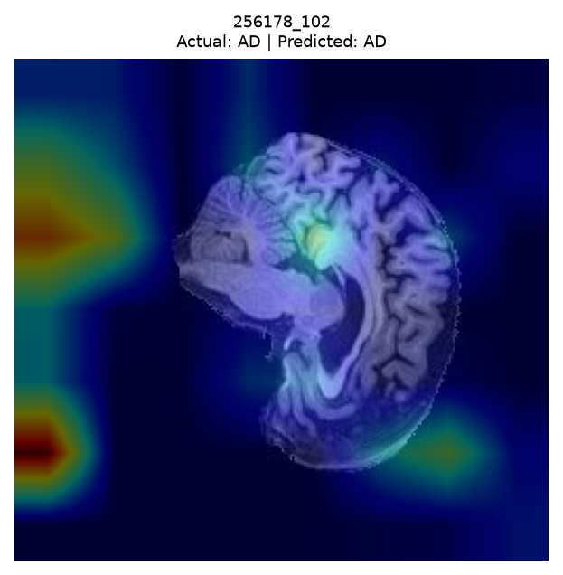
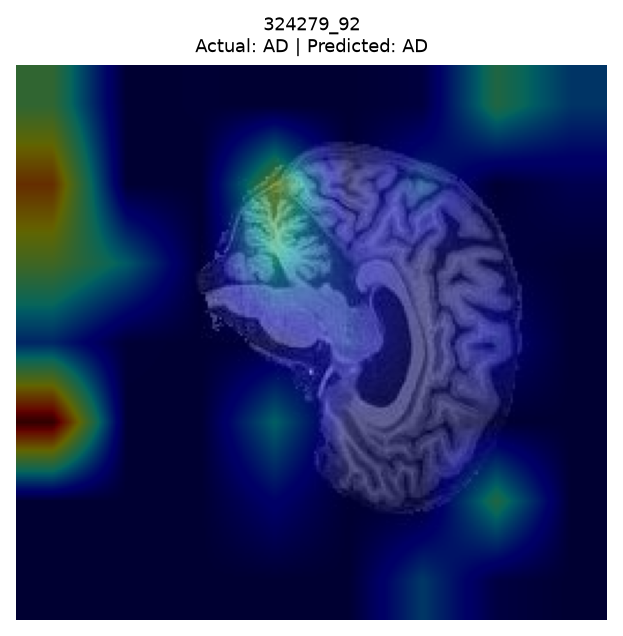
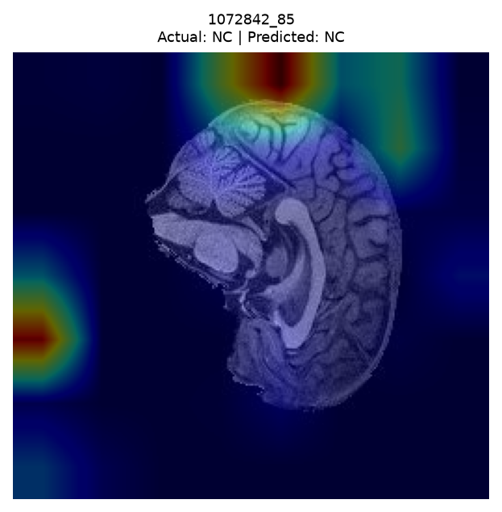
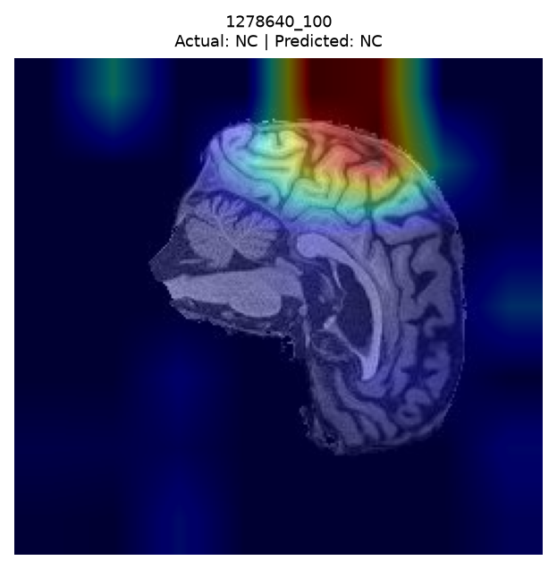


## Appendix B. Baseline incorrect Grad-CAM's
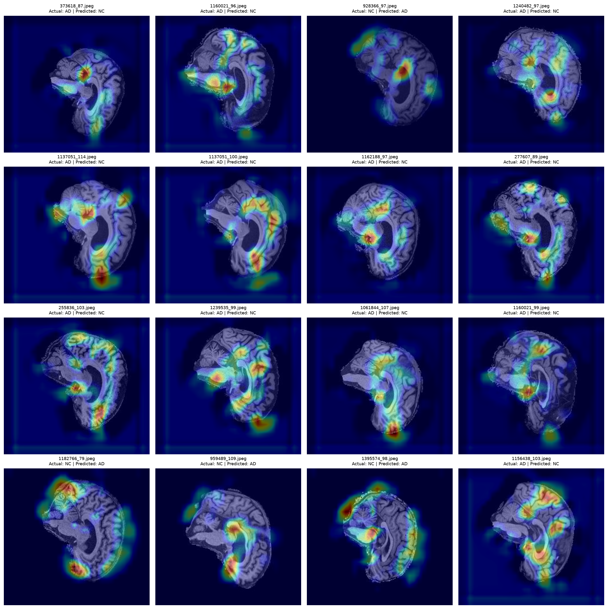
